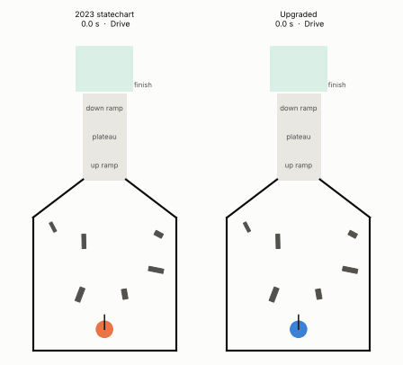
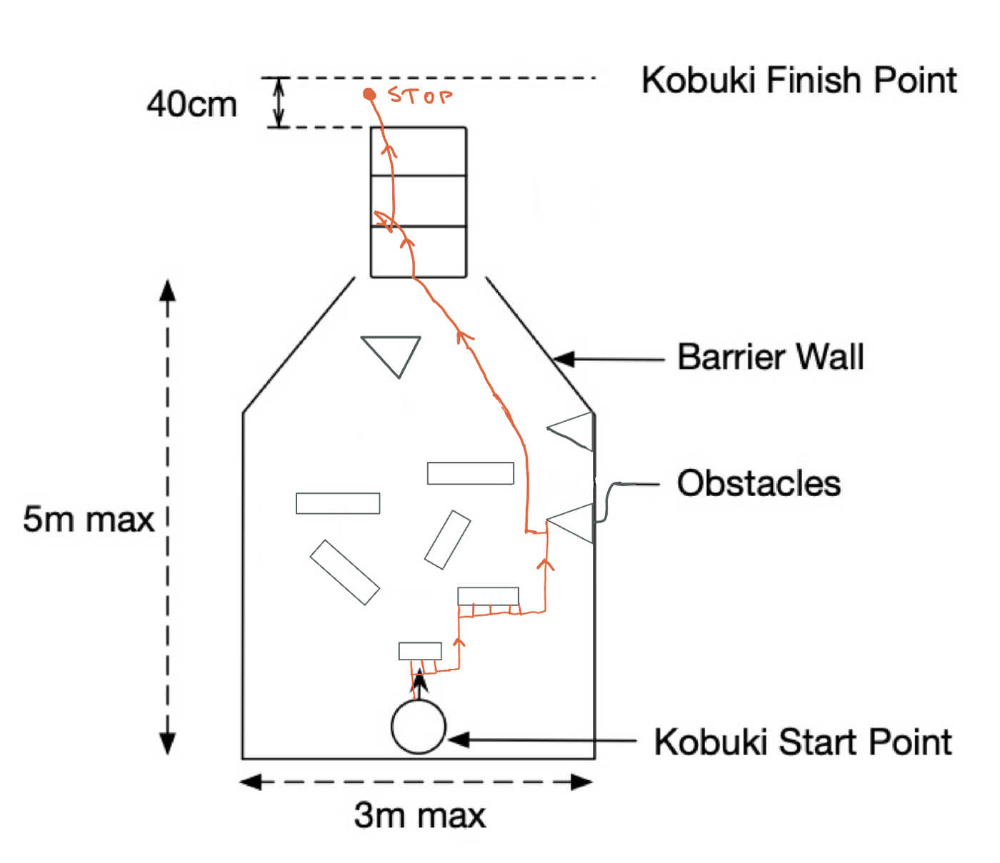
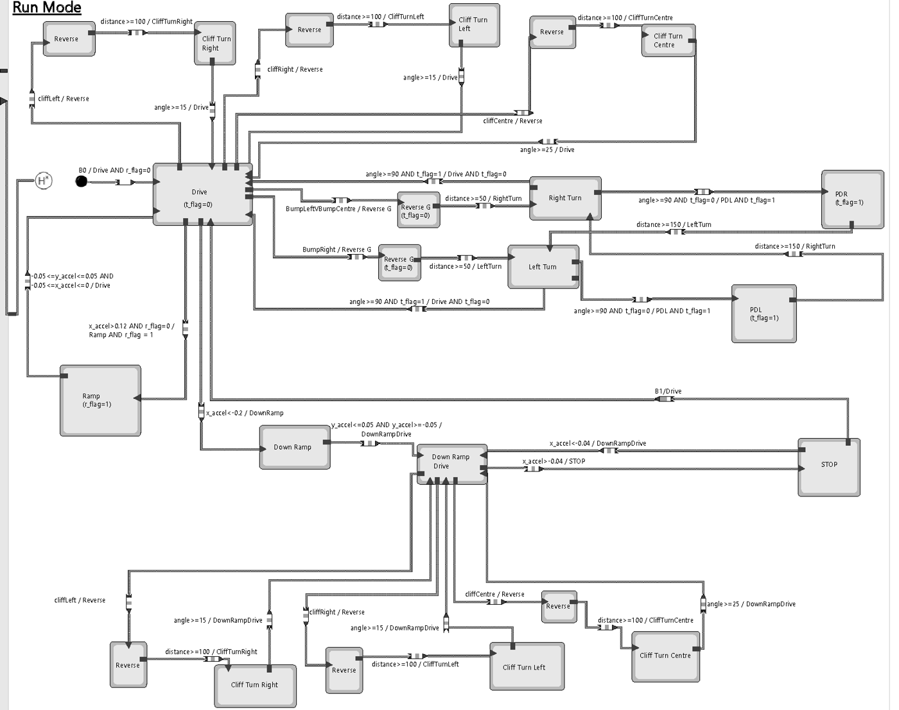
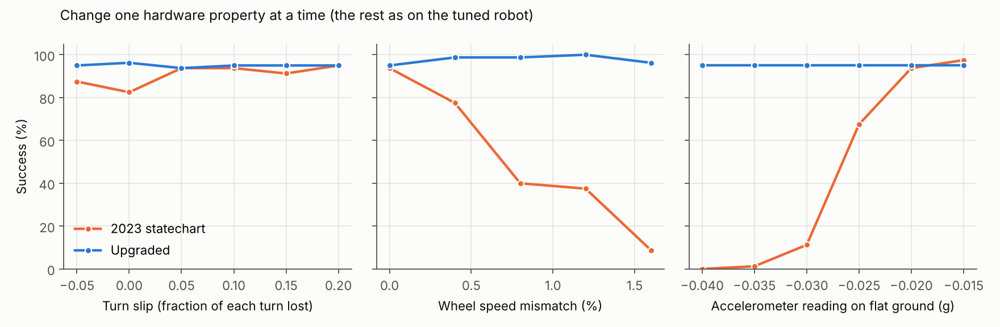
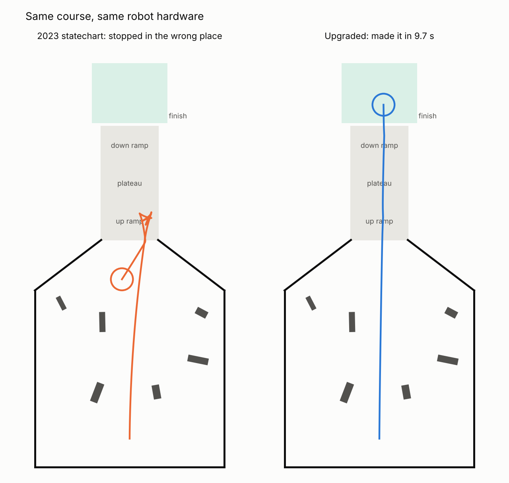

# Kobuki Hill Climb: Statechart, Simulator and Upgrades

An autonomous Kobuki robot that crosses an obstacle course, climbs a ramp, crosses the plateau without driving off the edge, comes down the other side and stops. Our team's run of **43.08 s was the fastest in the class** in the final speed test.

This was a team project in Embedded Systems Design (ELEN90066) at the University of Melbourne (2023), part of my Master of Mechatronics Engineering. We built the controller as a LabVIEW statechart on a myRIO. Since then I've ported that statechart to Python and built a Kobuki simulator around it that reproduces the hardware problems from our report. With the simulator I measured how robust our design really was, found what breaks it, and tested fixes.



**Results over 200 random courses each:**

| Setup | Success |
|---|---|
| 2023 statechart, robot like the one we tuned it on | 88.5% |
| 2023 statechart, random lab robot | 37.5% |
| Upgraded statechart, random lab robot | **98.5%** |
| Upgraded statechart, random lab robot, 700 mm/s (Kobuki top speed) | **98.5%** |

---

## The 2023 project

| | |
|---|---|
|  |  |
| Kobuki with the myRIO on top | Path of our 43.08 s speed test run |

**Hardware:**
- Kobuki base with bumpers, cliff sensors and wheel encoders
- myRIO with an accelerometer, used to sense the slope

**Requirements:**
- Hold the starting orientation and drive around obstacles.
- Climb, cross and come down the ramp.
- Stop at the bottom.
- Never turn more than 180° on the spot, and no chattering.

### Statechart



| Part | How it works |
|---|---|
| **Obstacles** | Bump, reverse 50 mm, turn 90° away, side step 150 mm, turn back, carry on. A `t_flag` guard stops side steps stacking into an endless zig zag. |
| **Ramp** | Accelerometer x above 0.12 g means the slope has started. The robot arcs until the sideways tilt is under 0.05 g, so it climbs straight. A `ramp_flag` guard allows this only once. |
| **Plateau edges** | Cliff sensor, reverse 100 mm, turn 15° (25° for the centre sensor) away from the edge. |
| **Down ramp and stop** | Accelerometer x below −0.2 g means the down slope. The robot squares up, drives down, and stops when x returns to the flat ground value (−0.04 g). Stop rechecks the reading so one noise spike can't stop it halfway down. |
| **Noise** | A 20 sample moving average on the accelerometer. |


## Simulator

[`kobuki/`](kobuki) is a 2D Kobuki and course simulator built to reproduce the problems we hit on the real hardware. The physics runs at 200 Hz and the statechart at 20 Hz.

| Real problem (from our report) | How the simulator models it |
|---|---|
| Turns never exactly 90° | In place turns slip, so the encoders over read the angle. Each robot has its own slip. |
| Robot drifts to one side, worse on the ramp | Wheel speed mismatch, plus gravity yawing a misaligned robot downhill |
| Accelerometer spikes, "jolting" at high speed | The accelerometer feels the robot's own starts, stops and bumps, plus noise |
| Each myRIO reads flat ground differently | Accelerometer offset per robot (−0.035 to −0.015 g) |
| Robot pushes into obstacles in side steps | Bodies slide along walls while the wheels keep spinning, and the encoders still count |
| Different Kobuki every week | Every run draws a new random "lab robot" |

The course is a 3 m wide arena with 4 to 7 random obstacles and a funnel into a 0.9 m wide ramp (up, plateau, down, with open edges). Success means the robot comes to rest on the floor within 1 m past the ramp without falling off.

[`kobuki/fsm_original.py`](kobuki/fsm_original.py) is a state by state port of our statechart: same states, guards, thresholds and wheel speeds as the speed test run.

## What broke the 2023 design


On a robot like the one we tuned it on, the 2023 statechart succeeds **88.5%** of the time, which fits how it did on the day. On a random lab robot it drops to **37.5%**. That's the "changing hardware" limitation from our report, now measured.

To find the cause, I changed one hardware property at a time:



- **Turn slip doesn't matter much.** Our 80° / 85° turn thresholds coped with every slip value tested (82–95%).
- **Wheel mismatch breaks it.** With no heading correction, one wheel just 0.8% faster drops success to 40%, and at 1.6% it's 9%. The robot drifts, reaches the ramp at an angle, then gets stuck, stops in the wrong place, or turns round and drives back down the ramp. We saw that last one in testing, and we fixed the drift by hand for each robot by speeding up the weaker wheel.
- **The accelerometer offset breaks the stop.** The Stop guard is −0.04 g, the same as our flat ground reading. When a robot's flat ground reading sits close to −0.04 g, the stopping jolt alone flips it back into DownRampDrive. The robot stutters forward and ends up past the finish. Success is 0% at −0.040 g and 94% at −0.020 g.

**The filter's tradeoff.** Taking the 20 sample filter out raises success on random robots from 37.5% to 59%, but falls off the ramp go from 1 run to 14. The filter did its job of stopping false transitions. Its 1 s delay, though, is what made the stop at the bottom late and stuttery.



## Upgrades

[`kobuki/fsm_upgraded.py`](kobuki/fsm_upgraded.py) keeps the same states and behaviour and fixes the items above, plus the ones from our report's future work:

| Upgrade | Fixes |
|---|---|
| **Gyro heading hold.** The Kobuki's gyro (unused in 2023) keeps straight drives on heading, and turns end on an absolute heading instead of "80° / 85° by the encoders". | Drift from wheel mismatch, turn errors building up, losing the ground orientation |
| **Motion compensated tilt sensing.** The wheel encoders give the robot's own acceleration, which is subtracted from the accelerometer before the slope is judged. | False Ramp / DownRamp / Stop transitions from jolts. This is what lets the speed go up. |
| **Clean stop.** A short average spots the floor, hysteresis rejects noise, then the robot drives a set distance on the encoders and stops for good. It lands about 30 cm past the bottom. | Stop ↔ DownRampDrive stutter, and the stop depending on each myRIO's offset |
| **Corner escape.** Three bumps within 8 s flips the turn direction and doubles the side step. | Getting stuck in corners (our first real run lost 20 s in one) |
| **Bumps during side steps.** The robot backs off and turns straight back to its heading. | Pushing into obstacles in PDL / PDR |
| **Shortest way round.** Turns always take the shorter direction. | Keeps every turn under 180° (largest seen: 128°) |

Result: **98.5% on random lab robots**, flat across every wheel mismatch and accelerometer offset tested, and still 98.5% at 700 mm/s.

## Tests

`python -m unittest discover -v tests` covers:

| Check | What it confirms |
|---|---|
| Physics and sensors | Matched wheels drive straight. Turn slip fools the encoders but not the gyro. Cliff sensors see the plateau edge. The correct bumper fires. |
| Validation rules from the report | Ramp is entered at most once. No turn over 180° on the spot. No side step straight after another side step without returning to Drive. |
| Performance | The tuned 2023 robot mostly succeeds. The upgrade beats the original on random hardware. |
| Motion compensation | A full speed start on flat ground isn't mistaken for a ramp. |

## Run it

```bash
pip install -r requirements.txt
python -m unittest discover -v tests
python experiments/run_experiments.py     # Monte Carlo comparison -> results/summary.json (~30 min on 2 cores)
python experiments/make_figures.py        # figures and the GIF (needs ffmpeg)
```

## Repo layout

```
kobuki/world.py          course: arena, random obstacles, ramp and cliff edges
kobuki/robot.py          Kobuki model: drive, bumpers, cliff sensors, encoders, accelerometer, gyro
kobuki/fsm_original.py   our 2023 statechart, ported state by state
kobuki/fsm_upgraded.py   upgraded statechart
kobuki/run.py            runs one course and judges the result
experiments/             Monte Carlo runs and figures
results/summary.json     all numbers in this README
media/                   diagrams, photos, plots, GIF
```

## Limitations

- The simulator is 2D with a simple slope model. Its numbers are for comparing designs, not for predicting lap times. Simulated runs take about 15 s against our real 43 s, because the real robot spent much longer recovering from each obstacle.
- The hardware ranges (slip, mismatch, offset) are estimates based on what we saw in the lab, not measurements.
- The original LabVIEW code isn't included. It only runs inside LabVIEW, and the course simulator (CyberSim) belonged to the subject.

## Credits

Team: Harry Tauber, Nathan Ruslim and me. The statechart, testing and the 43.08 s run were team work. The Python port, the simulator, the upgrades and the experiments are my later work. The report isn't included.
