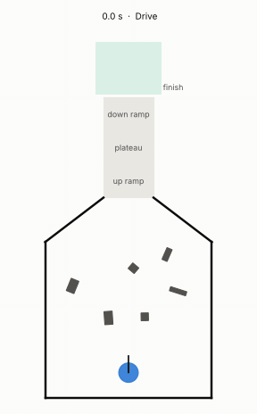
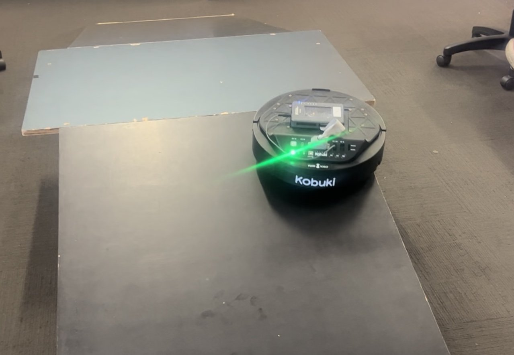
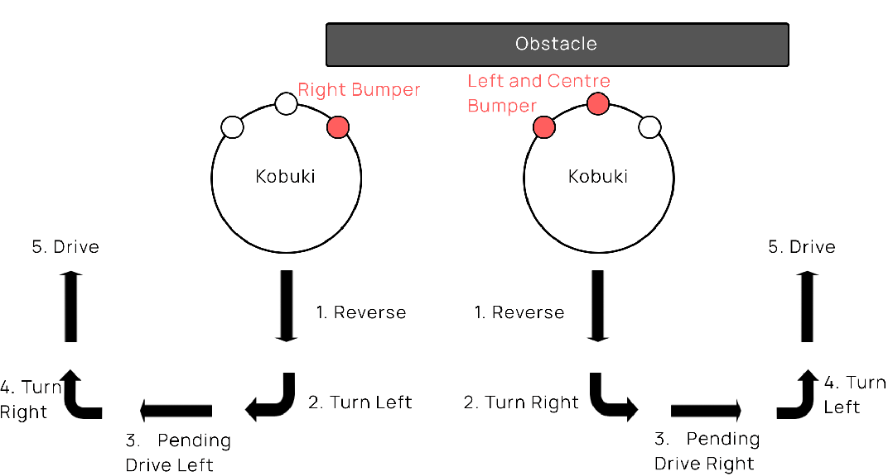
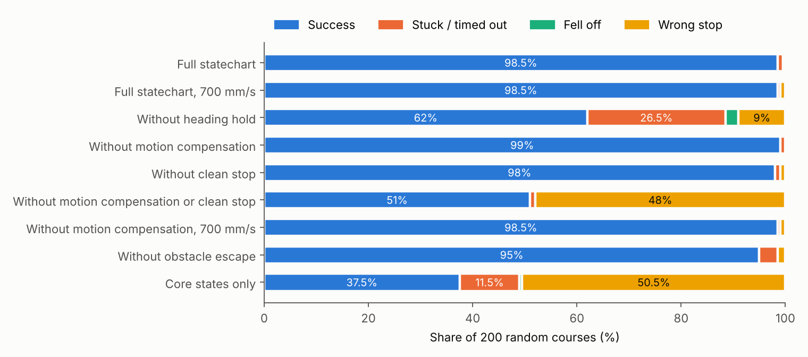

# Kobuki Hill Climb: Statechart Control and Simulation

An autonomous Kobuki robot that crosses an obstacle course, climbs a ramp, crosses the plateau without driving off the edge, comes down the other side and stops. Our team's run of **43.08 s was the fastest in the class** in the final speed test.

Built in Embedded Systems Design (ELEN90066) at the University of Melbourne, part of my Master of Mechatronics Engineering. The controller is a statechart, first built in LabVIEW on a myRIO and implemented here in Python, together with a Kobuki simulator that models the real hardware problems: wheel mismatch, turn slip, accelerometer offsets and jolts.



**Over 200 random courses, each with a random robot:**

| Setup | Success |
|---|---|
| Full statechart | **98.5%** |
| Full statechart at 700 mm/s (Kobuki top speed) | **98.5%** |

---

## The hardware

| | |
|---|---|
|  |  |
| Kobuki with the myRIO on top | Path of our 43.08 s speed test run |

- Kobuki base with bumpers, cliff sensors, wheel encoders and a gyro
- myRIO with an accelerometer, used to sense the slope

**Requirements:**
- Hold the starting orientation and drive around obstacles.
- Climb, cross and come down the ramp.
- Stop at the bottom.
- Never turn more than 180° on the spot, and no chattering between states.

## Statechart


| Part | How it works |
|---|---|
| **Obstacles** | Bump, reverse 50 mm, turn 90° away, side step 150 mm, turn back, carry on. A flag guard stops side steps stacking into an endless zig zag. |
| **Ramp** | Accelerometer x above 0.12 g means the slope has started. The robot arcs until the sideways tilt is under 0.05 g, so it climbs straight. A `ramp_flag` guard allows this only once. |
| **Plateau edges** | Cliff sensor, reverse 100 mm, turn 15° (25° for the centre sensor) away from the edge, then hold the new heading for 30 cm. |
| **Down ramp and stop** | Accelerometer x below −0.2 g means the down slope. The robot squares up, drives down, spots the floor and stops a set distance past the bottom. |
| **Noise** | A 20 sample (1 s) moving average on the accelerometer. |



On top of the core states, [`kobuki/statechart.py`](kobuki/statechart.py) has four features that make it work on any lab robot, not just the one it was tuned on:

| Feature | What it does |
|---|---|
| **Gyro heading hold** | The Kobuki's gyro keeps straight drives on heading, and turns end on an absolute heading (shortest way round) instead of an encoder angle. |
| **Motion compensated tilt** | The wheel encoders give the robot's own acceleration, which is subtracted from the accelerometer before the slope is judged. Starts, stops and bumps no longer look like slopes. |
| **Clean stop** | A short average spots the floor, hysteresis rejects noise, then the robot drives a set distance on the encoders and stops for good. |
| **Obstacle escape** | Three bumps within 8 s means a corner: flip the turn direction and side step further. A bump during a side step backs off and turns straight back to heading. |

## Simulator

[`kobuki/`](kobuki) is a 2D Kobuki and course simulator. The physics runs at 200 Hz and the statechart at 20 Hz.

| Real problem | How the simulator models it |
|---|---|
| Turns never exactly 90° | In place turns slip, so the encoders over read the angle. Each robot has its own slip. |
| Robot drifts to one side, worse on the ramp | Wheel speed mismatch, plus gravity yawing a misaligned robot downhill |
| Accelerometer spikes at high speed | The accelerometer feels the robot's own starts, stops and bumps, plus noise |
| Each myRIO reads flat ground differently | Accelerometer offset per robot (−0.035 to −0.015 g) |
| Robot pushes into obstacles | Bodies slide along walls while the wheels keep spinning, and the encoders still count |
| Different Kobuki every week | Every run draws a new random lab robot |

The course is a 3 m wide arena with 4 to 7 random obstacles and a funnel into a 0.9 m wide ramp (up, plateau, down, with open edges). Success means the robot comes to rest on the floor within 1 m past the ramp without falling off.


## Design study: what each feature is worth

The full statechart was run on 200 random courses, then again with features switched off.



- **Heading hold matters most.** Without it, success drops to 62%. The robot drifts, reaches the ramp at an angle and gets stuck (26% of runs time out).
- **Motion compensation and clean stop back each other up.** Either one alone is enough to stop cleanly at the bottom (99% and 98%). Without both, half the runs stop in the wrong place (51%), because a jolt or a robot's accelerometer offset flips the stop guard.
- **Obstacle escape** adds the last few percent (95% without it), mostly in corners where the robot would otherwise keep bouncing between obstacles.
- **Core states only:** 37.5%. On random hardware, the core states alone aren't enough.

To see which hardware problem each feature handles, one property was changed at a time:


- **Wheel mismatch** is what heading hold is for. Without it, one wheel just 0.8% faster drops success to 34%, and 1.6% drops it to 8%. With the gyro, success stays at 95 to 100%.
- **Turn slip** fools the encoders, but it isn't the main cause of failures. Without heading hold, success sits at 62 to 79% whatever the slip, because drift dominates. With the gyro, 94 to 96%.
- **Accelerometer offset** is what stop sensing is for. The stop guard is −0.04 g, so a myRIO that reads −0.040 g on flat ground never stops in the right place without it (0%), while one at −0.020 g gets 89%. With stop sensing, success stays at 95% across the range.

## Tests

`python -m unittest discover -v tests` covers:

| Check | What it confirms |
|---|---|
| Physics and sensors | Matched wheels drive straight. Turn slip fools the encoders but not the gyro. Cliff sensors see the plateau edge. The correct bumper fires. |
| Validation rules | Ramp is entered at most once. No turn over 180° on the spot. No side step straight after another side step without returning to Drive. |
| Performance | The full statechart handles random hardware, and its features add robustness over the core states. |
| Motion compensation | A full speed start on flat ground isn't mistaken for a ramp. |

## Run it

```bash
pip install -r requirements.txt
python -m unittest discover -v tests
python experiments/run_experiments.py     # design study -> results/summary.json (about 45 min on 2 cores)
python experiments/make_figures.py        # figures and the GIF (needs ffmpeg)
```

## Repo layout

```
kobuki/world.py          course: arena, random obstacles, ramp and cliff edges
kobuki/robot.py          Kobuki model: drive, bumpers, cliff sensors, encoders, accelerometer, gyro
kobuki/statechart.py     the hill climb statechart, with switchable features
kobuki/run.py            runs one course and judges the result
experiments/             design study and figures
results/summary.json     all numbers in this README
media/                   diagrams, photos, plots, GIF
```

## Limitations

- The simulator is 2D with a simple slope model. Its numbers are for comparing designs, not for predicting lap times. Simulated runs take about 15 s against our real 43 s, because the real robot spent much longer recovering from each obstacle.
- The hardware ranges (slip, mismatch, offset) are estimates based on what we saw in the lab, not measurements.
- The LabVIEW project isn't included. It only runs inside LabVIEW, and the course simulator (CyberSim) belonged to the subject.

## Credits

Team: Harry Tauber, Nathan Ruslim and me. Statechart design, testing and the 43.08 s run were team work.
